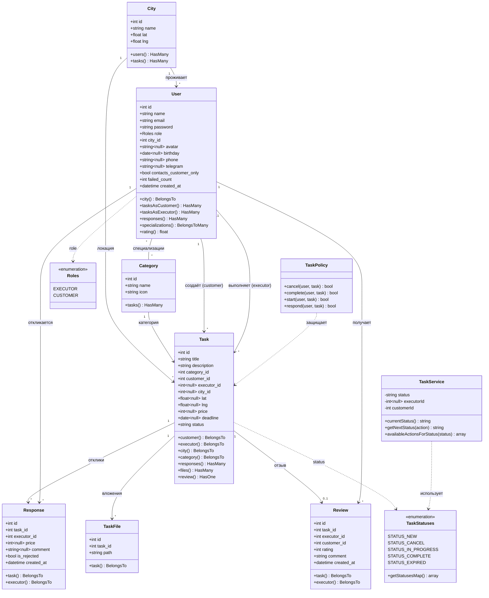

# Диаграмма классов (доменная модель)

Диаграмма отражает предметную область TaskForce. Существующие сущности отмечены как `есть`, недостающие по
ТЗ — как `добавить`.

## Статус сущностей

| Сущность                | Состояние | Комментарий                                                              |
|-------------------------|-----------|-------------------------------------------------------------------------|
| `User`                  | есть      | нужно дополнить полями профиля и `failed_count`                          |
| `City`                  | есть      | —                                                                       |
| `Category`              | есть      | связь с `Task` перевести на `category_id`                                |
| `Task`                  | есть      | добавить `executor_id`, `category_id`; связи `responses/files/review`   |
| `Response` (отклик)     | добавить  | 2.4, 2.8, список откликов на странице задания                           |
| `Review` (отзыв)        | добавить  | 2.5, рейтинг и список отзывов в профиле (4.7)                            |
| `TaskFile` (вложение)   | добавить  | 2.2, прикреплённые файлы                                                 |
| `user_categories` (pivot) | добавить | специализации исполнителя (4.7, 4.8)                                    |
| `Roles`, `TaskStatuses` | есть      | enum-ы                                                                   |
| `TaskService`           | есть      | конечный автомат статусов                                               |
| `TaskPolicy`            | есть      | правила доступа (Gates/Policies)                                         |
