# Устройство импорта файлов

Документ описывает, как разложить загрузку CSV в модели Eloquent по объектам.
Речь про сценарий сидера: файл `database/initialization/categories.csv` или
`cities.csv` превращается в строки `Category` и `City`.

Каждый объект на диаграммах ниже отвечает на один вопрос.

| Объект | Вопрос, на который он отвечает |
|---|---|
| `CategorySeeder` | Какой файл, какая модель и какой маппер нужны этому сидеру |
| `DataImporter` | В каком порядке идут открытие, перевод строк и запись в базу |
| `TabularReader` | Какие колонки у уже открытой таблицы и какова следующая запись |
| `CsvFileReader` | Как прочитать CSV, не выпуская `SplFileObject` наружу |
| `ExtensionReaderFactory` | Какой читатель создать по расширению файла |
| `RecordMapper` | Как имена колонок файла становятся атрибутами модели |

`DataImporter` не знает, что в `cities.csv` колонка называется `long`, а поле модели — `lng`.
`CsvFileReader` не знает, что у `Category` есть `display_name`.

## Диаграмма классов

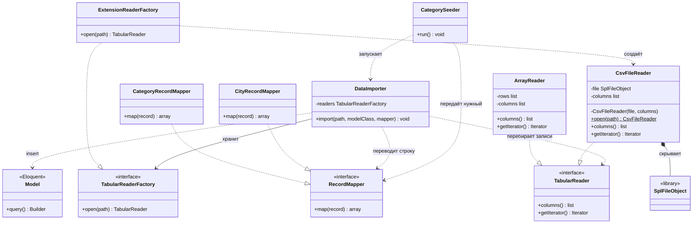

Как читать стрелки:

| Стрелка | Смысл |
|---|---|
| `..|>` | класс реализует интерфейс |
| `*--` | композиция: часть живёт и умирает вместе с целым, снаружи её нет |
| `-->` | хранит зависимость всё время жизни |
| `..>` | пользуется в одном вызове, не хранит |
| `$` у метода | метод статический |
| `-` у члена | член приватный |

`ArrayReader` на диаграмме — вторая реализация `TabularReader` для теста.
Он отдаёт заранее подготовленные строки. Фабрика по расширению его не создаёт:
тест сам передаёт такой читатель или подставляет свою фабрику.

## Роли объектов

### CategorySeeder

Собирает конкретный сценарий и вызывает его. Для категорий путь ведёт на
`categories.csv`, модель — `Category::class`, преобразователь —
`CategoryRecordMapper`. Для городов те же места занимают `cities.csv`,
`City::class` и `CityRecordMapper`. Сидер не открывает файл и не собирает SQL.

### DataImporter

Один метод делает весь сценарий:

1. Просит фабрику открыть путь и получает `TabularReader`.
2. Идёт по записям.
3. Каждую запись отдаёт `RecordMapper`.
4. Передаёт готовые атрибуты в `Model::query()->insert()`.

Фабрику импортёр получает в конструкторе и хранит. Читатель и маппер живут
только внутри вызова `import()`. Импортёр не смотрит расширение, не вызывает
`fgetcsv()` и не переименовывает колонки.

После `map()` импортёр может сверить ключи строки со списком `fillable` модели.
Чужой ключ — ошибка маппера, её видно сразу, а не в ответе базы.

### TabularReader

Это уже открытая таблица. К моменту, когда объект попал в руки импортёра:

- `columns()` возвращает имена колонок из заголовка;
- обход итератора даёт только строки данных;
- каждая строка — словарь `колонка => текст ячейки`;
- заголовка среди записей нет;
- полуоткрытого состояния нет: объект либо получен из `open()`, либо его нет.

Интерфейс ничего не говорит про CSV. Поэтому его могут реализовать и
`CsvFileReader`, и `ArrayReader`.

### CsvFileReader

Единственный класс, который видит `SplFileObject`. Конструктор приватный.
Снаружи существует только `CsvFileReader::open(path)`: метод открывает файл,
включает флаги разбора CSV, один раз читает заголовок и возвращает читатель,
у которого курсор уже стоит на первой записи.

Флаги `READ_CSV`, `READ_AHEAD`, `SKIP_EMPTY`, `DROP_NEW_LINE` остаются здесь.
Импортёр про них не знает. Пустой заголовок и файл, который не открылся,
превращаются в исключения из раздела ниже. Исходное исключение PHP передаётся
третьим аргументом, чтобы не потерять причину.

### ExtensionReaderFactory

Смотрит на расширение пути и создаёт конкретный читатель. Вся развилка по
формату живёт в этом классе. Новый формат — новый класс читателя и одна ветка
в `open()`. `DataImporter` и сидеры при этом не меняются.

### RecordMapper

Переводит одну запись читателя в массив атрибутов модели. Одна запись на
входе, один массив на выходе. Маппер не читает файл и не пишет в базу.

Два текущих файла расходятся с моделями, поэтому преобразователей два.

`categories.csv` содержит `name,icon`. У `Category` поля `name`,
`display_name`, `icon`, причём `name` — строковый первичный ключ.
В файле `name` — русская подпись, а ключ совпадает со значением `icon`.

| Колонка файла | Поле `Category` |
|---|---|
| `name` | `display_name` |
| `icon` | `name` и `icon` |

`cities.csv` содержит `name,lat,long`. У `City` поле называется `lng`.
`CityRecordMapper` же приводит `lat` и `lng` к `float`: массовый `insert()`
не прогоняет casts модели.

| Колонка файла | Поле `City` |
|---|---|
| `name` | `name` |
| `lat` | `lat` |
| `long` | `lng` |

Строка категории проходит границу так:

```text
читатель:  name = Курьерские услуги, icon = courier
маппер:    name = courier, display_name = Курьерские услуги, icon = courier
```

Строка города:

```text
читатель:  name = Абаза, lat = 52.6517296, long = 90.0885929
маппер:    name = Абаза, lat = 52.6517296, lng = 90.0885929
```

### Model

На диаграмме это любой класс Eloquent, в который идёт вставка: `Category` или
`City`. Импортёр вызывает `query()->insert()` и не создаёт модель только ради
списка полей.

## Последовательность вызовов

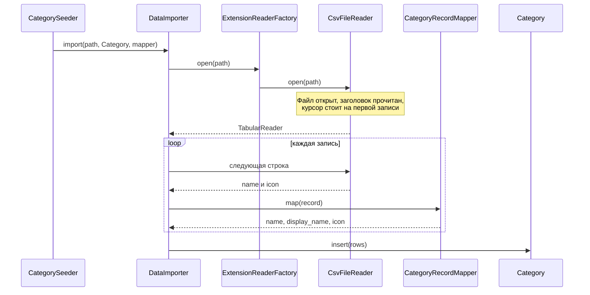

Для городов стрелки те же. Меняются аргументы `import()`: путь к
`cities.csv`, класс `City` и `CityRecordMapper`. Ветки «если категория, если
город» внутри `DataImporter` нет.

## Исключения

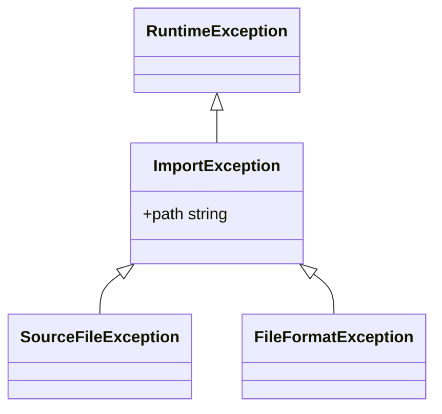

Метод возвращает только успешный результат. Ошибка выходит через `throw`.
В сообщение входят путь и, для битой строки, её номер. Исходное исключение
библиотеки сохраняется как `previous`.

| Ситуация | Кто бросает | Тип |
|---|---|---|
| Файла нет или его не удалось открыть | `CsvFileReader.open()` | `SourceFileException` |
| Пустой или битый заголовок | `CsvFileReader.open()` | `FileFormatException` |
| Неизвестное расширение | `ExtensionReaderFactory.open()` | `FileFormatException` |
| В строке нет колонки, которую ждёт маппер | `RecordMapper.map()` | `FileFormatException` |
| Маппер вернул поле вне `fillable` | `DataImporter.import()` | `FileFormatException` |

`DataImporter` эти исключения не глотает. Для сидера исключение и есть
результат неудачного импорта.

## Паттерны

Ниже у каждого паттерна две схемы. Первая — роли паттерна сами по себе.
Вторая — те же роли на классах импорта.

Один класс может занимать несколько ролей. `CsvFileReader` одновременно
адаптер над `SplFileObject`, конкретный итератор таблицы и продукт
именованного конструктора.

### Iterator

Задача: обойти набор элементов, не раскрывая, как набор устроен внутри.
Клиент пишет цикл. Курсор, файл и способ хранения остаются у коллекции.

Участники в классической форме:

| Роль | Обязанность |
|---|---|
| Aggregate | Умеет выдать итератор по своим элементам |
| Iterator | Умеет отдать следующий элемент и сказать, есть ли он |
| ConcreteAggregate | Конкретная коллекция |
| ConcreteIterator | Курсор этой коллекции |

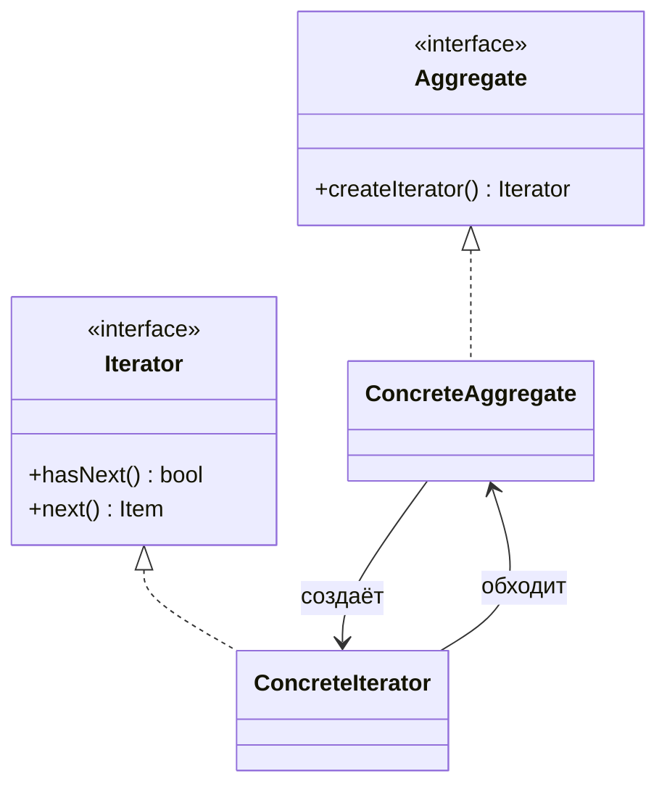

В PHP ту же роль закрывает `IteratorAggregate`. Метод `getIterator()` возвращает
генератор, и `foreach` сам запрашивает следующий элемент. Отдельный класс
курсора появляется, когда курсор надо передавать, копировать или отматывать
назад. Для файла достаточно генератора внутри читателя.

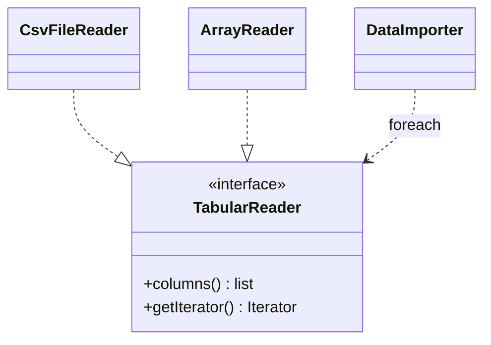

`DataImporter` выглядит так:

```php
$reader = $this->readers->open($path);

$rows = [];
foreach ($reader as $record) {
    $rows[] = $mapper->map($record);
}
```

Что отсюда следует:

- импортёр перебирает записи и не двигает файловый указатель;
- заголовок в этот цикл не попадает: `open()` уже его съел;
- чтение остаётся ленивым, пока импортёр сам не сложит строки в массив перед `insert()`;
- тест подставляет `ArrayReader` с тремя массивами, и цикл импортёра не меняется.

Словарь записи — часть контракта итератора. Ключи берутся из `columns()`.
Позиционный список `['Курьерские услуги', 'courier']` заставляет следующий
объект помнить порядок колонок. Словарь этот порядок прячет.

### Adapter

Задача: встроить готовый класс в интерфейс, который ждёт клиент, не переписывая
сам готовый класс.

| Роль | Обязанность |
|---|---|
| Target | Интерфейс, удобный клиенту |
| Adaptee | Готовый класс с другим интерфейсом |
| Adapter | Переводит вызовы Target в вызовы Adaptee |
| Client | Работает только с Target |

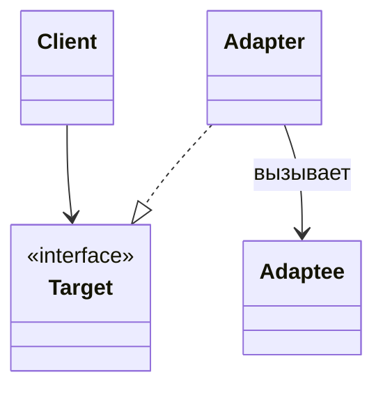

На импорте роли такие:

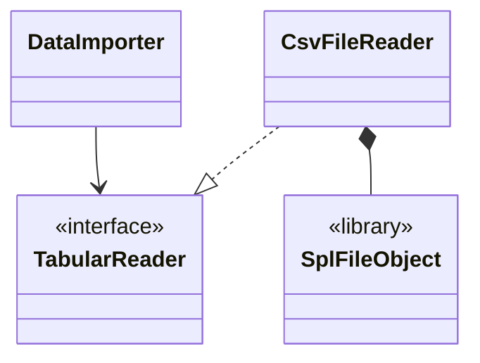

`SplFileObject` умеет `rewind()`, `fgetcsv()`, `eof()`, флаги и имя файла.
Клиенту импорта нужно другое: колонки и поток словарей. `CsvFileReader`
принимает вызовы `columns()` и `getIterator()` и внутри них вызывает SPL.

Пока `SplFileObject` стоит в сигнатурах интерфейса, адаптера нет: клиент
сам говорит на языке библиотеки и сам соблюдает порядок «сначала заголовок,
потом строки». После переноса этого порядка внутрь `open()` и `getIterator()`
библиотечный тип из интерфейса уходит.

Второй адаптер к тому же Target — `ArrayReader`. Он адаптирует массив PHP,
а не файл. Для импортёра оба выглядят как таблица.

### Именованный конструктор

Задача: получить объект только в согласованном состоянии. Обычный конструктор
это тоже умеет. Отдельное имя нужно, когда создание — это операция со смыслом:
«открыть файл», а не «записать два поля».

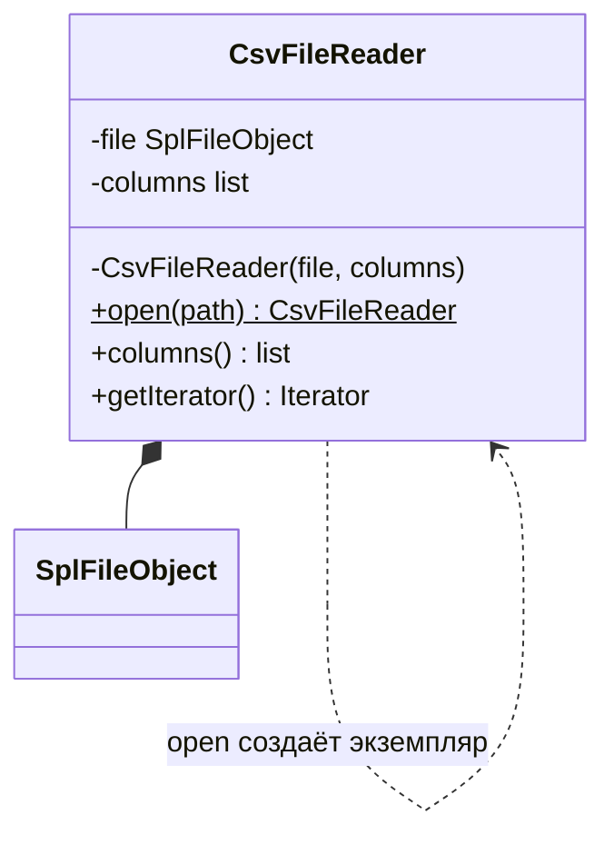

`open()` делает пять вещей подряд:

1. Проверяет, что путь существует и открывается.
2. Создаёт `SplFileObject` и ставит флаги CSV.
3. Читает первую строку и проверяет, что это непустой список имён.
4. Запоминает имена в `columns`.
5. Возвращает объект, у которого следующая читаемая строка — уже данные.

Приватный конструктор оставляет эту последовательность единственным входом.
Вызывающий код не может собрать читатель с пустым списком колонок и не может
вызвать чтение заголовка отдельным шагом в неправильном порядке.

Это статический фабричный метод конкретного класса: он создаёт экземпляр
самого `CsvFileReader`. Рядом часто ставят имя из каталога GoF — «фабричный
метод». У того паттерна другой состав участников, он разобран ниже. Здесь
иерархии создателей нет, есть одна операция `open()`.

Эскиз границы:

```php
final class CsvFileReader implements TabularReader
{
    private function __construct(
        private SplFileObject $file,
        private array $columns,
    ) {}

    public static function open(string $path): self
    {
        // SourceFileException, если путь не открылся.
        // FileFormatException, если заголовок пустой.
        // Вернуть self с уже прочитанным заголовком.
    }
}
```

### Простая фабрика

Задача: собрать выбор конкретного класса в одном месте. Клиент просит продукт
по интерфейсу и передаёт признак, по которому фабрика выбирает класс.

Простой фабрики нет в каталоге GoF. Это отдельный приём: один класс с методом,
который по параметру решает, какой `new` выполнить.

| Роль | Обязанность |
|---|---|
| Simple Factory | Смотрит на признак и создаёт продукт |
| Product | Интерфейс продукта |
| Concrete Product | Класс, который фабрика умеет создавать |

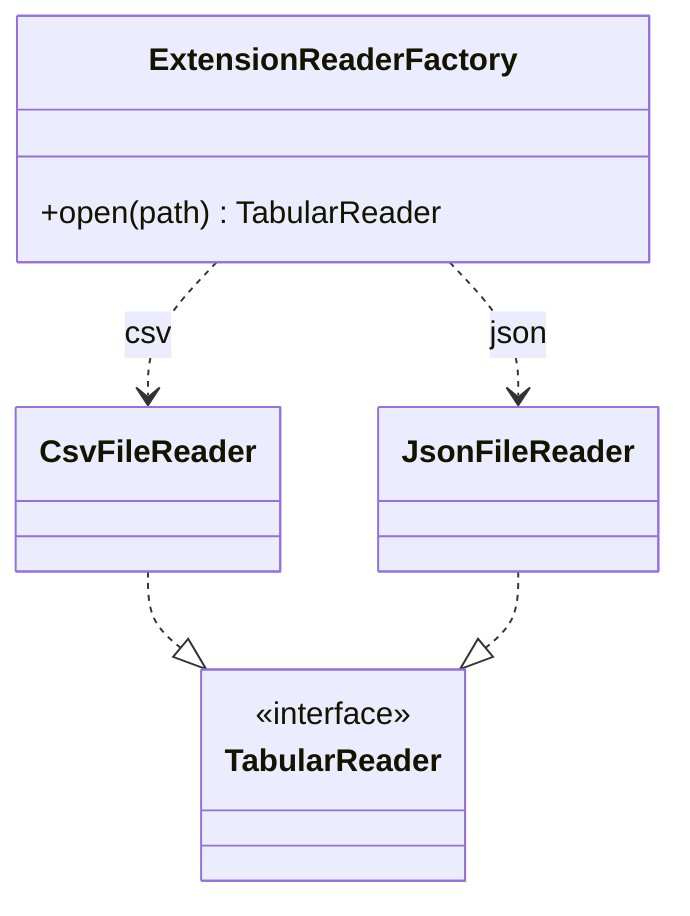

`JsonFileReader` на схеме — будущий класс. Его нет в коде, пока нет JSON.
Схема показывает, куда он встанет: рядом с `CsvFileReader`, плюс одна ветка
в фабрике. `DataImporter` остаётся прежним.

```php
final class ExtensionReaderFactory implements TabularReaderFactory
{
    public function open(string $path): TabularReader
    {
        $extension = strtolower(pathinfo($path, PATHINFO_EXTENSION));

        return match ($extension) {
            'csv' => CsvFileReader::open($path),
            default => throw new FileFormatException("Формат не поддерживается: $extension"),
        };
    }
}
```

Фабрика выбирает класс. `CsvFileReader::open()` приводит выбранный класс в
годное состояние. Это две разные работы, поэтому это два разных объекта.

Расширение стоит приводить к нижнему регистру: `.CSV` и `.csv` — один формат.

### Фабричный метод

Задача в формулировке GoF: базовый класс задаёт порядок операции, а решение,
какой продукт создать, оставляет наследнику. Наследник переопределяет один
метод, который возвращает продукт.

| Роль | Обязанность |
|---|---|
| Creator | Хранит общий сценарий и объявляет фабричный метод |
| Concrete Creator | Реализует фабричный метод и выбирает класс продукта |
| Product | Интерфейс продукта |
| Concrete Product | Класс, который создаёт конкретный создатель |

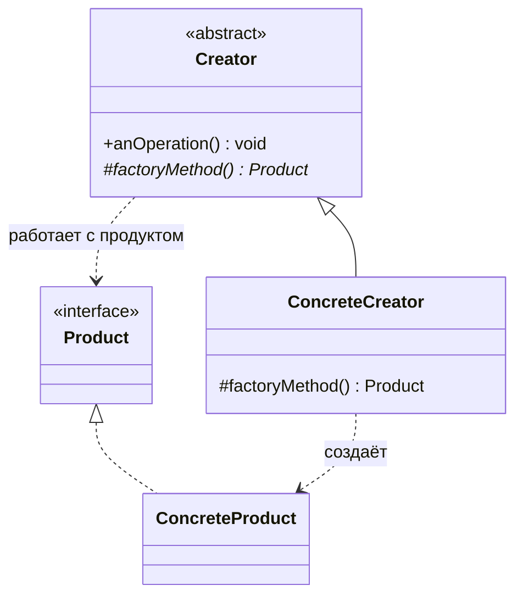

Общий сценарий живёт в `anOperation()` и вызывает `factoryMethod()` там, где
нужен продукт. Новый вид продукта — новый наследник Creator. Базовый сценарий
не редактируется.

Для текущего импорта этот приём тяжелее, чем нужно. Формат файла меняется
отдельно от алгоритма записи в базу, и выбирается по расширению, а не по
классу импортёра. Это закрывают простая фабрика и Strategy. Фабричный метод
становится уместен, когда появятся разные создатели с общим скелетом и своим
продуктом. Например, базовый отчёт, у которого наследник сам решает, какой
источник строк создать.

Именованный конструктор `CsvFileReader::open()` и фабричный метод GoF легко
перепутать по имени. Различие в составе объектов. `open()` — метод продукта,
он создаёт сам себя. Фабричный метод — метод создателя, его переопределяет
наследник, а продукт он только возвращает.

### Strategy

Задача: вынести сменяемый кусок поведения в отдельный объект с общим
интерфейсом. Контекст хранит алгоритм целиком и в нужном месте вызывает
стратегию. Смена поведения — смена объекта, а не правка контекста и не новый
наследник.

| Роль | Обязанность |
|---|---|
| Context | Общий алгоритм, вызывает стратегию |
| Strategy | Интерфейс сменяемого шага |
| Concrete Strategy | Один вариант этого шага |

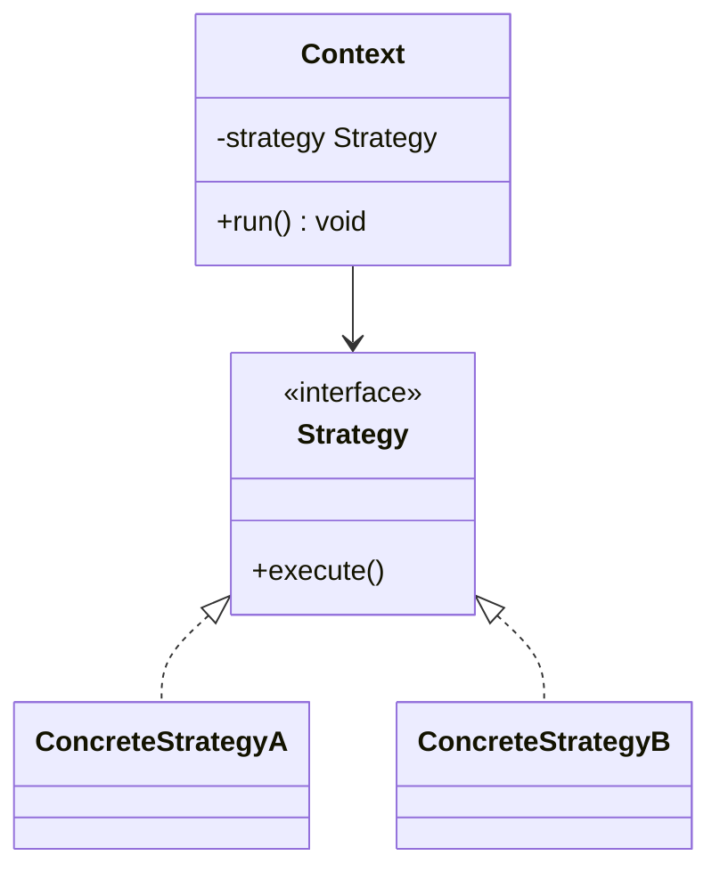

В импорте контекст один — `DataImporter`. Сменяемых шага два, и это две
стратегии, а не одна.

Чтение:

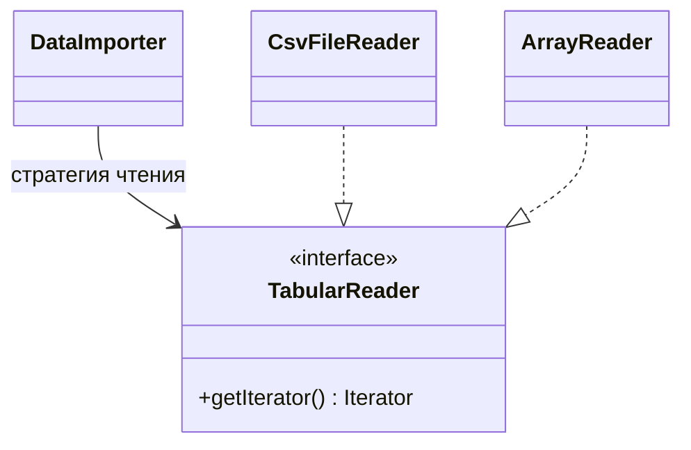

Перевод строки в атрибуты:

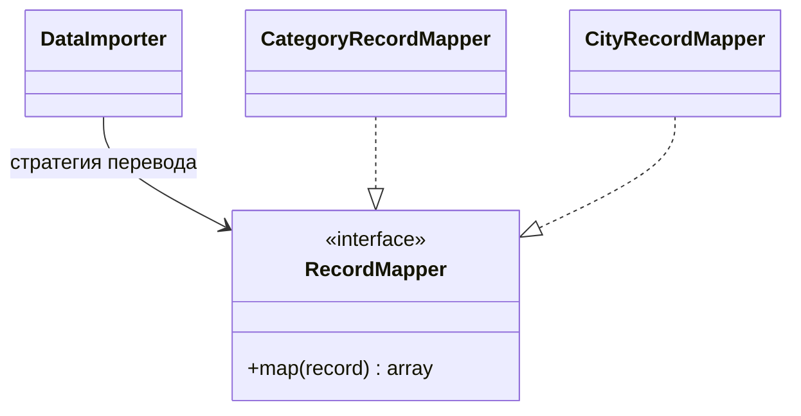

Стратегии независимы. Города из CSV — это `CsvFileReader` плюс
`CityRecordMapper`. Тот же городской маппер в тесте работает поверх
`ArrayReader`. Категории из будущего JSON — новый читатель плюс уже
написанный `CategoryRecordMapper`.

```php
interface RecordMapper
{
    /**
     * @param array<string, string> $record строка читателя
     * @return array<string, mixed> атрибуты модели
     */
    public function map(array $record): array;
}

final class CategoryRecordMapper implements RecordMapper
{
    public function map(array $record): array
    {
        return [
            'name' => $record['icon'],
            'display_name' => $record['name'],
            'icon' => $record['icon'],
        ];
    }
}

final class CityRecordMapper implements RecordMapper
{
    public function map(array $record): array
    {
        return [
            'name' => $record['name'],
            'lat' => (float) $record['lat'],
            'lng' => (float) $record['long'],
        ];
    }
}
```

Отсутствие нужного ключа в `$record` — `FileFormatException` с именем колонки.
Маппер не подставляет пустую строку вместо битых данных.

### Dependency Injection

Задача: класс получает сотрудников извне, а не создаёт их сам. Кто собирает
объекты, тот и решает, какие реализации войдут в сценарий. Это место называют
composition root. В сидере им является сам сидер. В приложении им может быть
сервис-провайдер Laravel.

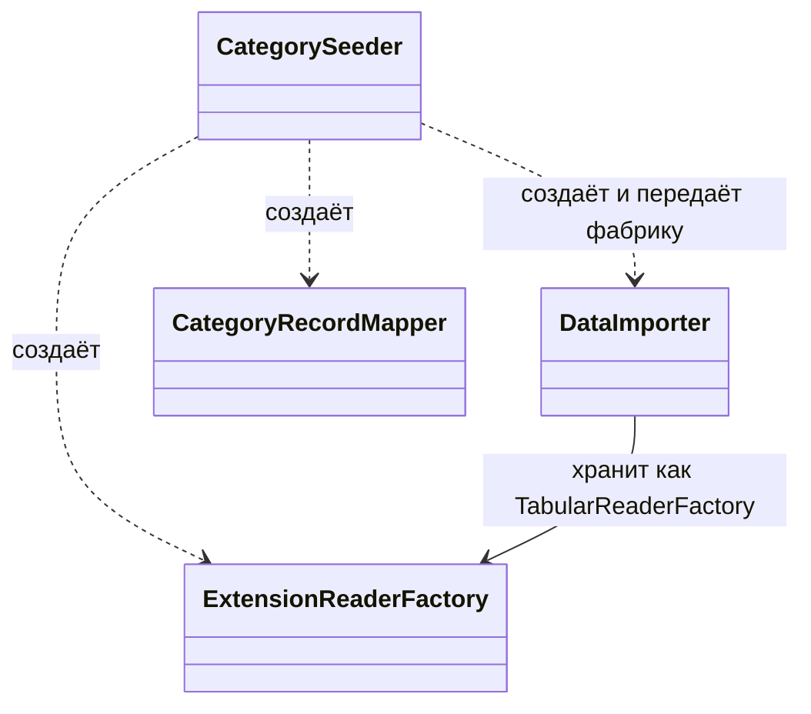

`DataImporter` зависит от `TabularReaderFactory`, а не от
`ExtensionReaderFactory` и не от `CsvFileReader`. В конструктор можно передать
любую фабрику с методом `open(path)`. Тестовая фабрика возвращает
`ArrayReader` и не трогает диск.

Маппер в этот конструктор не кладётся. Один импортёр обслуживает и категории,
и города, а маппер у них разный. Поэтому маппер приходит аргументом
`import()` на один вызов. Фабрика чтений у импортёра одна на всю жизнь
объекта, она хранится в поле.

```php
$importer = new DataImporter(new ExtensionReaderFactory());

$importer->import(
    __DIR__ . '/../initialization/categories.csv',
    Category::class,
    new CategoryRecordMapper(),
);
```

Перед работой с классом модели импортёр проверяет
`is_a($modelClass, Model::class, true)`. Опечатка в имени класса тогда
становится ошибкой импорта с понятным текстом.

### Template Method

Задача: зафиксировать порядок шагов в базовом классе и дать наследникам
подменить отдельные шаги. Скелет один. Вариация идёт через наследование.

| Роль | Обязанность |
|---|---|
| Abstract Class | Метод-скелет вызывает шаги в фиксированном порядке |
| Concrete Class | Реализует те шаги, которые помечены как абстрактные |

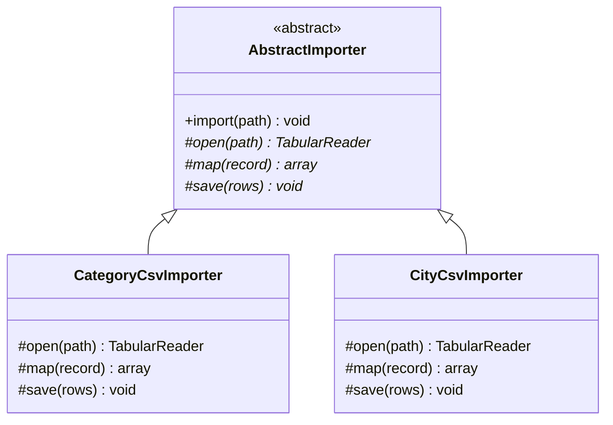

Скелет `import()` у базового класса всегда один: открыть, для каждой записи
вызвать `map()`, затем `save()`. Наследник категории реализует эти три шага
по-своему, наследник города — по-своему.

Приём хорошо ложится на семейство классов, у которых общий порядок действий и
различается именно реализация шагов. Новый вариант — новый наследник.

У загрузки файлов TaskForce шаги меняются независимо друг от друга. Формат
файла и соответствие колонок — две разные оси: CSV с городами, CSV с
категориями, позже тот же городской словарь поверх другого формата. При
наследовании каждая пара «формат + модель» стала бы отдельным классом.
Strategy оставляет оси раздельными: читатель подставляется сам по себе,
маппер подставляется сам по себе, скелет остаётся одним `DataImporter`.

Template Method и Strategy решают одну потребность — варьировать шаг алгоритма.
В первом случае шаг — метод наследника. Во втором — объект, переданный в
контекст.

## Сборка сценария

Интерфейсы, которые фиксируют границы:

```php
interface TabularReader extends IteratorAggregate
{
    /** @return list<string> */
    public function columns(): array;

    /** @return Traversable<int, array<string, string>> */
    public function getIterator(): Traversable;
}

interface TabularReaderFactory
{
    public function open(string $path): TabularReader;
}

interface RecordMapper
{
    /**
     * @param array<string, string> $record
     * @return array<string, mixed>
     */
    public function map(array $record): array;
}
```

Скелет импорта:

```php
final class DataImporter
{
    public function __construct(private TabularReaderFactory $readers) {}

    /**
     * @param class-string<Model> $modelClass
     */
    public function import(string $path, string $modelClass, RecordMapper $mapper): void
    {
        $reader = $this->readers->open($path);

        $rows = [];
        foreach ($reader as $record) {
            $rows[] = $mapper->map($record);
        }

        $modelClass::query()->insert($rows);
    }
}
```

Сидер категорий после этого становится сборкой объектов, а не местом, где
читается файл:

```php
public function run(): void
{
    $importer = new DataImporter(new ExtensionReaderFactory());

    $importer->import(
        __DIR__ . '/../initialization/categories.csv',
        Category::class,
        new CategoryRecordMapper(),
    );
}
```

Тест проверяет перевод строки без файла и без базы. `ArrayReader` реализует
тот же `TabularReader`. Отдельная тестовая фабрика возвращает его из `open()`.
Дальше вызывается обычный `import()` с моделью, подменённой на уровень запроса,
либо проверяется только маппер:

```php
$attributes = (new CategoryRecordMapper())->map([
    'name' => 'Курьерские услуги',
    'icon' => 'courier',
]);

// name = courier
// display_name = Курьерские услуги
// icon = courier
```

Так тест держится за контракт маппера. Путь к CSV и соединение с MySQL в нём
не участвуют.

## Какой класс какую роль играет

| Класс | Роли |
|---|---|
| `DataImporter` | Контекст Strategy, клиент Iterator и Adapter |
| `TabularReader` | Target адаптера, агрегат Iterator, стратегия чтения |
| `CsvFileReader` | Adapter над `SplFileObject`, конкретная таблица, продукт `open()` |
| `ArrayReader` | Вторая стратегия чтения для теста |
| `ExtensionReaderFactory` | Простая фабрика |
| `TabularReaderFactory` | Интерфейс, через который импортёр получает фабрику |
| `RecordMapper` | Стратегия перевода записи в атрибуты |
| `CategoryRecordMapper`, `CityRecordMapper` | Конкретные стратегии перевода |
| `CategorySeeder` | Composition root: создаёт импортёр, фабрику и маппер |
| `ImportException` и наследники | Контракт ошибок на границах `open()`, `map()` и `import()` |
